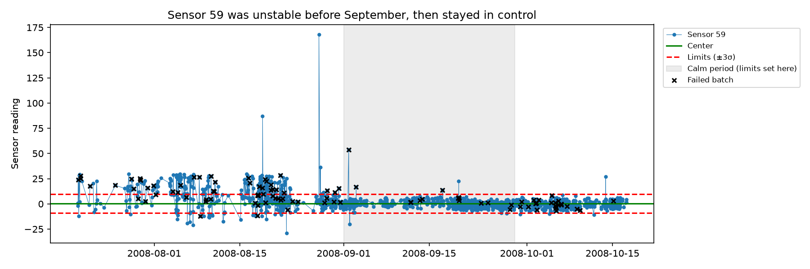
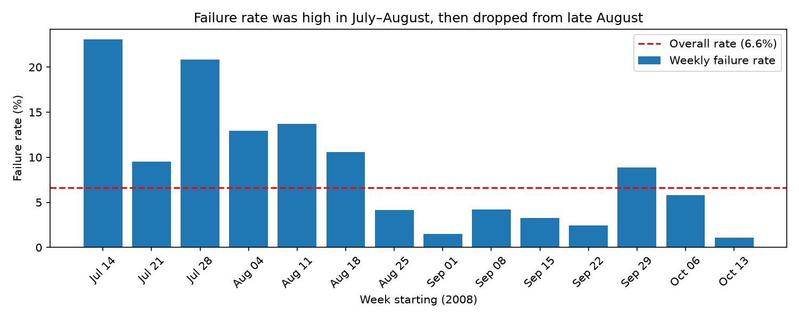

# Early Warning Signs of Failure in Semiconductor Manufacturing

Analysis of the [UCI SECOM dataset](https://archive.ics.uci.edu/dataset/179/secom): 
1,567 production runs from a semiconductor fab, each with 590 sensor readings and a 
pass/fail result (104 failures, 6.6%). The goal was to find which sensors signal failures, 
monitor them with statistical process control (SPC), and test whether failures can be 
predicted on future runs.

## Key findings

**1. A process change in sensor 59 matches a drop in failures.**
Before late August 2008, sensor 59 swung far outside its control limits and ~13% of runs 
failed. From September on, it stayed in control and the failure rate fell to ~4%. 
Runs with high sensor 59 readings failed about 4x as often (18.6% vs 4.4%).

**2. Two independent methods agreed on the top warning sensors.**
Mann-Whitney tests with Benjamini-Hochberg correction found 23 of 446 sensors that differ 
on failed runs. A random forest's three most important sensors (59, 247, 519) matched the 
statistical tests' top three, in the same order.

**3. Prediction weakened on later data because the process drifted.**
Using a time-based split (train on the first 70% of runs, test on the last 30%), a random 
forest scored a PR-AUC of 0.077 vs 0.055 for random guessing. The later failures occurred 
while sensor 59 was in control, meaning they had a different cause the model hadn't seen.

## Recommendations
- Monitor sensor 59 with an individuals control chart; it clearly flags the unstable period.
- Investigate the October failures separately, since they need different warning sensors.
- Retrain prediction models regularly on recent data, because the process changes over time.

## Methods
1. **Cleaning:** removed 116 constant sensors and 28 sensors missing in >50% of runs; 
   filled the remaining 1.6% of blank values with each sensor's median.
2. **Time trends:** weekly failure rates across July–October 2008.
3. **SPC:** individuals control charts with ±3σ limits (σ estimated from the average 
   moving range) set on a stable baseline period (Sept 1–28).
4. **Sensor screening:** Mann-Whitney U tests with Benjamini-Hochberg false discovery rate 
   correction, cross-checked with random forest feature importance.
5. **Evaluation:** time-based train/test split; PR-AUC and failures caught when flagging the 
   riskiest 10–30% of runs, compared against random guessing.

## Limitations
- Sensor names are anonymized, so physical causes can't be confirmed; the sensor 59 
  explanation is a hypothesis.
- The test period contains only 26 failures, so test scores are approximate.
- Cleaning steps (which sensors to drop, median values) used all runs rather than only 
  the training period; with 1.6% of values filled, the effect should be small.

## How to run
1. Download `secom.data` and `secom_labels.data` from the 
   [UCI page](https://archive.ics.uci.edu/dataset/179/secom) into `data/raw/`.
2. Install packages: `pip install -r requirements.txt`
3. Open `secom_final.ipynb` and run all cells.

## Data source
SECOM dataset by M. McCann and A. Johnston, UCI Machine Learning Repository (2008).
